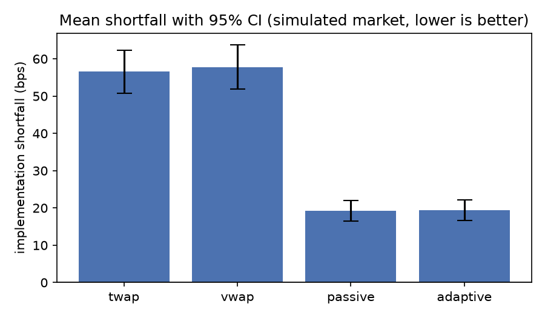
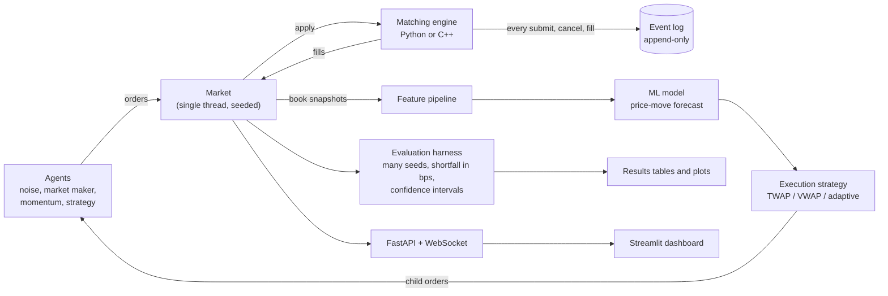

# LOBX

A limit-order-book exchange simulator with an ML-assisted trade execution agent, written in Python
and C++17. LOBX simulates a stock exchange with a real matching engine, fills it with simulated
traders, and asks one question: can an execution strategy sell a large order for a lower cost than
the standard TWAP and VWAP algorithms? Cost is measured as implementation shortfall in basis points.

**Everything here is a simulation.** No real market data, broker or exchange is used, and no result
says anything about real-market performance or profitability.

## The short version of the results

All numbers: sell 3,000 shares over 5 simulated minutes, 200 held-out test seeds, mean cost in basis
points (lower is better) with a 95% confidence interval. Command and details in
[`docs/results.md`](docs/results.md).

`python -m lobx.cli eval --strategies twap,vwap,passive,adaptive --seeds 200`

| strategy | seeds completed | incomplete | mean (bps) | std (bps) | 95% CI for the mean (bps) |
|---|---:|---:|---:|---:|---|
| twap | 198 | 2 | 56.54 | 41.14 | [50.77, 62.31] |
| vwap | 197 | 3 | 57.81 | 42.22 | [51.88, 63.74] |
| passive | 200 | 0 | 19.25 | 19.54 | [16.53, 21.98] |
| adaptive | 200 | 0 | 19.45 | 19.77 | [16.69, 22.20] |

- A strategy that **rests limit orders** instead of crossing the spread is about 37 bps cheaper than
  TWAP or VWAP on 99% of seeds, and always finishes.
- **The ML model adds nothing.** `passive` is the adaptive strategy with the model switched off, and
  it costs the same (difference +0.19 bps, 95% CI [-0.06, 0.45]). Letting the model trigger market
  orders made things worse. See [What failed](#what-failed).



## What is in the box

| Part | Where | What it does |
|---|---|---|
| Matching engine, Python | `src/lobx/engine/book_py.py` | Readable reference: price-time priority, limit and market orders, cancels, partial fills |
| Matching engine, C++ | `cpp/`, bound with pybind11 | Same behaviour, much faster; tested against the Python engine on a million random orders |
| Event log and replay | `src/lobx/engine/event_log.py`, `replay.py` | Every submit, cancel and fill is logged; a log replays to the identical book |
| Simulator | `src/lobx/sim/` | Seeded clock and random streams; noise traders, a market maker, a momentum trader |
| Execution strategies | `src/lobx/strategies/` | TWAP, VWAP, and an adaptive strategy (passive limit orders, model-driven aggression, deadline safety nets) |
| ML | `src/lobx/ml/` | Features from the book, a short-horizon price-move label, naive / logistic / LightGBM models |
| Evaluation | `src/lobx/eval/` | Many seeds, shortfall in bps, confidence intervals, paired comparison, a lookahead test |
| Service | `src/lobx/service/`, `dashboard/` | FastAPI API, WebSocket book stream, Streamlit dashboard |

## Architecture



The engine is the only component that changes the book. A run is a pure function of its
configuration and seed. More detail, including what each stage may and may not touch:
[`docs/architecture.md`](docs/architecture.md).

## Install

Needs Python 3.11 or newer, a C++17 compiler (g++ or clang++) and CMake 3.18 or newer.

```bash
git clone <this repository> lobx && cd lobx
pip install -e .                 # builds the C++ engine and installs the package
pip install -e ".[service]"      # optional: the API and the dashboard
```

For development, use the lock file: `uv sync --locked --all-extras` (installs the tests and linters
too). The tools use the C++ engine when it is built and the Python engine otherwise; asking for the native engine explicitly without a build raises a clear error.

## Use

```bash
python -m lobx.cli run --seed 0                  # simulate a market, write an event log
python -m lobx.cli replay run-seed-0.eventlog    # replay the log; verifies the same final book
python -m lobx.cli train --out models            # train the models (about 2 minutes)
python -m lobx.cli eval --strategies twap,vwap,passive,adaptive --seeds 200   # about 6 minutes
python -m lobx.cli serve                         # the API on http://localhost:8000/docs
streamlit run dashboard/app.py                   # the dashboard on http://localhost:8501
docker compose up                                # both of the above, in containers
```

## Reproduce the numbers

Every number in this README and in [`docs/results.md`](docs/results.md) has the command that
produced it written next to it. A run is a pure function of its configuration and seed, so the same
command prints the same numbers. The test seeds (1000 to 1199) are never used for training or tuning
(training uses 0 to 99; tuning uses validation seeds 100 to 199).

```bash
pytest                                          # all tests, including the Python-vs-C++ differential test
cmake -S . -B build/cpp -DLOBX_BUILD_TESTS=ON && cmake --build build/cpp && ./build/cpp/lobx_bench 1000000
python benchmarks/bench_engines.py --ops 1000000
```

## Tests and checks

- Unit tests and property tests (`hypothesis`) for the book: it never crosses and quantities never go
  negative.
- Differential test: the Python and C++ engines give identical fills and snapshots on one million
  random orders.
- Determinism and replay tests: the same seed gives a byte-identical event log, and a log replays
  to the same book.
- Lookahead tests: a strategy that peeks at the future is caught; features at time t use only data
  up to t.
- C++ unit tests, also under AddressSanitizer and UndefinedBehaviorSanitizer.
- CI runs the lot on Linux and macOS (`.github/workflows/ci.yml`).

## Limitations

Read these before quoting any number.

- **It is a simulation.** The market is made of three simple kinds of agent (Poisson noise traders,
  a market maker that skews its quotes with inventory, a momentum trader). There is no real data,
  no informed trading, no latency, no fees or rebates, and no hidden or iceberg orders. Resting
  orders fill easily here because noise traders keep sending market orders; in a real market,
  passive orders face adverse selection and are harder to get filled. The size of the gap between
  passive and aggressive execution should not be expected to carry over.
- **The order is scaled to the market.** The plan's example was 50,000 shares over 30 minutes. The
  simulated market trades only about 3,000 shares a minute, so the experiments sell 3,000 shares
  over 5 minutes, about 20% of the volume in that window. That is a large share of volume.
- **No intraday volume pattern.** Every simulated minute looks alike, so the estimated VWAP profile
  is flat and VWAP is nearly the same algorithm as TWAP here. This says nothing about VWAP in
  real markets.
- **Incomplete runs are excluded, which flatters the baselines.** In 2 of 200 seeds TWAP and in 3
  of 200 VWAP did not finish selling (the book was too thin; a market order's unfilled remainder
  is discarded). Those seeds are left out of the baselines' means, and they are probably the
  expensive ones. Paired comparisons use only seeds where both strategies finished.
- **Statistics are modest.** 200 seeds, one scenario, intervals that assume the mean of the seeds
  is roughly normal. The model's accuracy numbers come from rows within runs that are strongly
  correlated, so the effective sample is closer to 100 seeds than to 134,000 rows, and they carry no
  confidence intervals. The adaptive threshold was chosen on 40 validation seeds from a coarse
  grid of five values.
- **The lookahead tests are not proofs.** They show that decisions and features up to time t do not
  change when later data is replaced, and that a planted bug is caught. They cannot show that no
  other leak exists.
- **Performance.** The C++ engine is about 15x faster than the Python engine in a pure C++
  benchmark, but only 2 to 3x faster when called from Python, because each call crosses the
  Python/C++ boundary. Evaluation time is dominated by the model and the features, not the engine
  (see `docs/results.md`, "Profile").
- **The service is a demo.** Jobs live in memory, there is no authentication, and the WebSocket
  replays a finished run at an adjustable pace rather than a market computed live. Do not expose
  it to the internet.
- **Not verified in the build sandbox.** The Docker image and the macOS CI jobs were written but
  could not be run where this was built (no route to Docker Hub or GitHub Actions). They are
  untested until the first real run.
- **One symbol, no reinforcement learning.** Multiple symbols, queue-position modelling, fees, and
  the optional Gymnasium/PPO phase were not built.

## What failed

Stated plainly, as the project rules require.

- **The ML model does not help execution.** The model does find signal: on held-out seeds it
  predicts the next second's price move with accuracy 0.599 against 0.451 for a naive baseline,
  and it is well calibrated. But the adaptive strategy that uses it costs 19.45 bps against 19.25
  bps for the same strategy with the model switched off (difference +0.19 bps, 95% CI
  [-0.06, 0.45]), and on validation seeds, the more often the forecast triggered a market order,
  the higher the cost. The threshold that tuning picked is one at which the model almost never
  fires. My untested explanations: a one-tick forecast is worth less than the spread and impact
  paid to act on it; momentum agents amplify market sells; resting orders simply earn the spread.
  The 37 bps advantage over TWAP and VWAP is real in this simulator, but it belongs to passive
  limit orders, not to machine learning.
- **VWAP did not beat TWAP.** It was 1.41 bps worse (95% CI [0.71, 2.10]), because the simulated
  volume has no pattern for it to follow.
- **The 10x speed target is met only in pure C++.** Called from Python the engine is 2.2x (wrapped)
  to 3.2x (raw) faster than the Python reference. A batch API (many orders per call) would remove
  most of the overhead; it was not built, so the end-to-end target is not met.
- **TWAP and VWAP sometimes could not finish.** 2 and 3 of 200 seeds, as described above.
- **Speeding up the engine did not speed up evaluation**, because the engine is about 5% of the
  time; the model call is about 59%.

## Project notes

- [`AGENTS.md`](AGENTS.md): the project's rules and phase plan
- [`docs/results.md`](docs/results.md): every reported number, with its command
- [`docs/learn/`](docs/learn): plain-language notes for each phase, with practice exercises
- [`docs/integration.md`](docs/integration.md): design decisions and deviations from the plan
