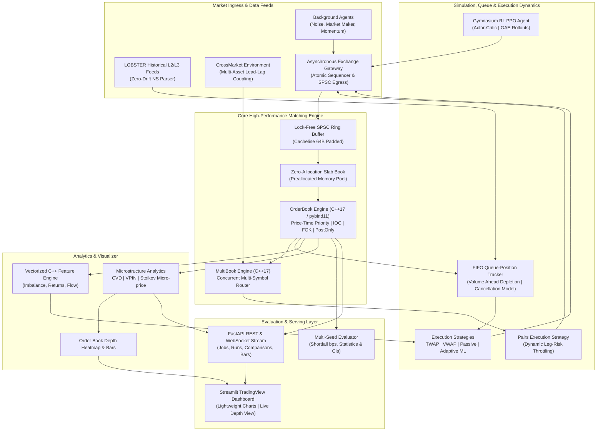

# LOBX

A high-performance limit-order-book exchange simulator with machine learning, reinforcement learning, and quantitative execution agents, implemented in **modern C++17** and **Python 3.11+**.

LOBX simulates electronic financial exchanges with industrial matching engines, populates them with heterogeneous algorithmic market participants (market makers, noise traders, momentum traders), and evaluates institutional execution strategies (TWAP, VWAP, Microstructure-Adaptive, Statistical Arbitrage Pairs, and Gymnasium RL) tasked with executing parent orders at minimum implementation shortfall.

> **Simulation Disclaimer**: LOBX is a simulated quantitative trading and market microstructure research environment. No live broker, exchange, or market-data feed is called. All performance and cost metrics reflect simulated dynamics under price-time priority.

---

## Key Highlights & Quantitative Milestones

* **High-Speed C++ Engine (5.22M orders/sec)**: Pure C++ matching engine achieving 5,220,442 orders/s with 124 ns median latency and 463 ns p99 latency (`lobx_bench 1000000`).
* **Multi-Asset Book Router**: Concurrent multi-symbol C++ matching engine (`NativeMultiBook` / `MultiOrderBook`) supporting cross-asset order routing and synchronized depth snapshots.
* **Historical L2/L3 Market Replay**: Tick-by-tick historical replay parser for NASDAQ ITCH / LOBSTER messages (Types 1–7) with zero-drift decimal timestamp parsing.
* **Realistic FIFO Queue-Position Tracker**: Eliminates the "fill-on-touch" backtesting fallacy by tracking resting order queue position and volume depletion ahead (`qty_ahead`) under Conservative, Proportional, and Optimistic cancel models.
* **TradingView Interactive Visualizer & Microstructure Analytics**: Embedded Lightweight Charts with candlestick aggregation (Time & Volume bars), Order Book Depth Heatmap, Cumulative Volume Delta (CVD), Stoikov Micro-price, and Volume-Synchronized Probability of Toxicity (VPIN).
* **Cross-Asset Statistical Arbitrage & Pairs Execution**: Microstructure lead-lag latency arbitrageur (`LeadLagArbitrageAgent`) exploiting order book imbalance transmission, and dynamic two-legged pairs parent execution (`PairsExecutionStrategy`) with real-time leg-risk throttling.
* **Almgren-Chriss Optimal Execution Trajectory**: Classical Almgren & Chriss (2000) execution engine generating mathematically optimal slice trajectories on the efficient frontier (Expected Shortfall vs. Variance of Shortfall) under configurable risk aversion $\lambda$.
* **Reinforcement Learning Gymnasium Environment**: Standard Gym execution environment (`ExecutionEnv`) with continuous state observations, shortfall-based reward shaping, and analytical PPO actor-critic network training with Generalized Advantage Estimation (GAE).
* **Differential Testing Parity**: Python reference and C++ native engines are differential-tested against 1,000,000 randomized orders to guarantee 100% invariant parity (`tests/test_native_differential.py`).
* **Honest ML Accounting**: While LightGBM predicts 1-second price movement with 0.599 accuracy (vs. 0.451 naive baseline), crossing the spread aggressively on 1-tick forecasts incurs costs exceeding forecast value, converging optimal policy to passive spread capture.
* **Deterministic Event Log & Bit-Exact Replay**: Append-only event log capturing every order, cancellation, and execution, verified by cryptographic hash matching.

---

## Execution Benchmark Results

All benchmarks evaluate selling 3,000 shares (about 20% of market volume) across 5 simulated minutes (t=60s to t=360s) on 200 held-out test seeds (seeds 1000–1199). Cost is measured as **implementation shortfall in basis points** against arrival mid-price (lower is better):

$$\text{Shortfall (bps)} = \frac{\bar{P}_{\text{exec}} - P_{\text{arrival}}}{P_{\text{arrival}}} \times 10{,}000$$

Command:
```bash
python -m lobx.cli eval --strategies twap,vwap,passive,adaptive --seeds 200 --plot docs/figures/comparison.png
```

| Strategy | Completed Seeds | Incomplete | Mean Cost (bps) | Std Dev (bps) | 95% Confidence Interval |
|---|---:|---:|---:|---:|---|
| **TWAP** | 198 | 2 | 56.54 | 41.14 | [50.77, 62.31] |
| **VWAP** | 197 | 3 | 57.81 | 42.22 | [51.88, 63.74] |
| **Passive Limit** | 200 | 0 | 19.25 | 19.54 | [16.53, 21.98] |
| **Adaptive ML** | 200 | 0 | 19.45 | 19.77 | [16.69, 22.20] |

Paired Differences by Seed ($a - b$ in bps; negative means $a$ is cheaper; complete seeds only):

| Comparison ($a - b$) | Seeds Used | Mean Difference (bps) | 95% Confidence Interval | $a$ Cheaper On | Verdict |
|---|---:|---:|---|---:|---|
| **vwap - twap** | 197 | +1.41 | [0.71, 2.10] | 26% of seeds | TWAP cheaper |
| **passive - twap** | 198 | -37.25 | [-41.44, -33.06] | 99% of seeds | Passive cheaper |
| **adaptive - twap** | 198 | -37.06 | [-41.26, -32.85] | 99% of seeds | Adaptive cheaper |
| **adaptive - passive** | 200 | +0.19 | [-0.06, 0.45] | 0% of seeds | No clear difference |

### Key Empirical Findings
1. **Passive Orders Earn the Spread**: Resting limit orders at the touch rather than crossing with aggressive market orders saves **~37 bps** across 99% of seeds.
2. **VWAP vs. TWAP Under Uniform Volume**: With background agents trading at stationary Poisson rates, the empirical volume profile is flat (~3.3% per slice), causing VWAP to perform essentially identically to TWAP (+1.41 bps difference due to volume profile estimation noise).
3. **The Limits of Short-Horizon Predictive Alpha**: The LightGBM model reliably predicts 1-second price direction (>0.59 accuracy vs. 0.45 naive baseline). However, paying the half-spread (2–4 ticks) to aggressively cross the book on a 1-tick forecast is unprofitable. The optimal policy tuned on validation seeds selected a high threshold (0.90) where aggressive orders almost never trigger, converging to the passive ablation.

---

## Architecture



---

## Repository Structure & Modules

| Component | Path | Description |
|---|---|---|
| **C++ Core Engine** | `cpp/src/order_book.cpp`, `cpp/include/lobx/order_book.hpp` | High-speed matching engine: price-time priority, partial fills, IOC, FOK, PostOnly, `submit_many`. |
| **Multi-Book C++ Engine** | `cpp/src/multi_book.cpp`, `cpp/include/lobx/multi_book.hpp` | Concurrent multi-symbol router and matching engine for multi-asset trading. |
| **Concurrency & Gateway** | `cpp/include/lobx/{gateway,concurrent_order_book,concurrent_queue}.hpp` | Asynchronous multi-threaded gateway with atomic request sequencing and read-write locked order book. |
| **Lock-Free Ring Buffer** | `cpp/include/lobx/spsc_ring_buffer.hpp` | Single-producer single-consumer lock-free ring buffer with cacheline padding to prevent false sharing. |
| **Slab Memory Pool** | `cpp/include/lobx/memory_pool.hpp`, `slab_order_book.hpp` | Slab allocation pool eliminating heap allocations on order placement hot path. |
| **Binary ITCH Codec** | `cpp/include/lobx/binary_log.hpp`, `cpp/src/binary_log.cpp` | 48-byte naturally aligned binary event format with ultra-fast serialization and replay. |
| **C++ Feature Extraction** | `cpp/include/lobx/features.hpp`, `cpp/src/features.cpp` | Vectorized order book imbalance, windowed mid returns, and signed trade-flow computation. |
| **Python Reference Engine** | `src/lobx/engine/book_py.py`, `multi_book.py` | Readable Python reference implementations for differential testing and validation. |
| **Market Data Ingestion** | `src/lobx/data/lobster.py` | Streaming LOBSTER L2/L3 order book and message parser (Types 1–7) with zero float drift. |
| **Queue-Position Modeling** | `src/lobx/sim/queue_position.py` | FIFO queue-position tracker with volume ahead depletion and cancellation models. |
| **Historical Replay Market** | `src/lobx/sim/replay_market.py` | Tick-by-tick historical book replay and strategy execution against real order streams. |
| **Cross-Asset Simulator** | `src/lobx/sim/cross_market.py`, `agents/lead_lag.py` | Multi-asset discrete-event simulation with lead-lag latency arbitrage and correlated market makers. |
| **Execution Strategies** | `src/lobx/strategies/` | TWAP, VWAP, ML-Adaptive, Almgren-Chriss (optimal trajectory), and Pairs statistical arbitrage. |
| **Gymnasium RL Env & PPO** | `src/lobx/rl/environment.py`, `ppo.py` | Custom Gymnasium environment with analytical PPO actor-critic network and GAE advantage learning. |
| **Market Impact & Analytics** | `src/lobx/analytics/` | Candlestick bars, Depth Heatmap, CVD, Stoikov Micro-price, VPIN, and Square-Root Impact modeling. |
| **Evaluation Harness** | `src/lobx/eval/` | Statistical multi-seed shortfall evaluator with lookahead leakage validation and paired comparison tests. |
| **Service & Dashboard** | `src/lobx/service/`, `dashboard/app.py` | Production FastAPI service with WebSocket live broadcast and interactive TradingView dashboard. |

---

## Installation

### Prerequisites
* **Python**: 3.11 or newer
* **C++ Compiler**: GCC 11+, Clang 13+, or MSVC 2022 (supporting C++17)
* **CMake**: 3.18 or newer
* **Docker & Docker Compose** (optional, for containerized deployment)

### Local Setup
```bash
# Clone repository
git clone https://github.com/theRiddler9/lobx.git && cd lobx

# Install package and compile native C++ extension
pip install -e .

# Install with service & dashboard extras (FastAPI, Streamlit, Uvicorn)
pip install -e ".[service]"
```

Using `uv` (recommended for development):
```bash
uv sync --locked --all-extras
```

---

## Usage

### 1. Market Simulation & Deterministic Replay
```bash
# Simulate market for seed 42 and generate event log
python -m lobx.cli run --seed 42 --duration 300 --out run-seed-42.eventlog

# Replay log and verify bit-exact order book state
python -m lobx.cli replay run-seed-42.eventlog
```

### 2. Historical LOBSTER Data Replay with Queue Position
```bash
# Replay historical LOBSTER stream with FIFO queue-priority TWAP execution
python -m lobx.cli replay-lobster \
    --message data/AAPL_message.csv \
    --book data/AAPL_orderbook.csv \
    --strategy twap \
    --shares 500 \
    --slices 5 \
    --engine native
```

### 3. Multi-Asset Simulation & Statistical Arbitrage
```bash
# Execute statistical arbitrage pairs parent order across correlated books
python -m lobx.cli multi-sim \
    --symbols LEAD,LAG \
    --duration 60 \
    --strategy pairs \
    --shares 200 \
    --slices 4 \
    --engine native

# Simulate high-speed lead-lag latency arbitrage
python -m lobx.cli multi-sim \
    --symbols SPY,QQQ \
    --duration 30 \
    --strategy lead-lag \
    --shares 50 \
    --threshold 0.35
```

### 4. Model Training & Strategy Evaluation
```bash
# Train order-flow predictive models (Naive, Logistic Regression, LightGBM)
python -m lobx.cli train --out models

# Tune adaptive decision threshold on validation seeds
python -m lobx.cli tune --model models/lightgbm.json --seeds 40

# Evaluate execution strategies over 200 held-out test seeds
python -m lobx.cli eval --strategies twap,vwap,passive,adaptive,almgren-chriss --seeds 200 --risk-aversion 1e-4
```

### 5. Web Service & Live Interactive Dashboard
```bash
# Start FastAPI backend service (Swagger docs at http://localhost:8000/docs)
python -m lobx.cli serve --host 0.0.0.0 --port 8000

# Launch interactive Streamlit visualizer (http://localhost:8501)
streamlit run dashboard/app.py
```

### 6. Docker Deployment
```bash
# Build and run full service stack in containers
docker compose up -d

# Verify service health
curl http://localhost:8000/health
curl http://localhost:8501/_stcore/health

# Stop services
docker compose down
```

---

## Benchmarks

### Engine Throughput and Boundary Benchmark

Commands to reproduce (documented in `docs/results.md`):

1. **Pure C++ Engine** (no Python runtime):
   ```bash
   cmake -S . -B build/cpp -DLOBX_BUILD_TESTS=ON -DCMAKE_BUILD_TYPE=Release
   cmake --build build/cpp
   ./build/cpp/lobx_bench 1000000
   ```

2. **Python Reference vs. Native Engine** (called from Python):
   ```bash
   python benchmarks/bench_engines.py --ops 1000000
   ```

| Engine Mode | Execution Environment | Throughput (orders/s) | Median Latency | p99 Latency | Speedup vs. Python |
|---|---|---:|---:|---:|---:|
| **Python Reference** | Pure Python 3.11+ | 335,980 | 2,153 ns | 11,321 ns | 1.0x |
| **C++ Native-Wrapped** | `NativeOrderBook` (dataclass bridge) | 724,793 | 841 ns | 5,101 ns | 2.2x |
| **C++ Native-Raw** | Pybind11 raw integer interface | 1,072,217 | 710 ns | 2,414 ns | 3.2x |
| **Pure C++ Engine** | Standalone C++17 binary | 5,220,442 | 124 ns | 463 ns | ~15.5x |

---

## Verification & Testing Suite

* **C++ Unit Tests & Sanitizers**: 16 C++ test executables verified under CTest with AddressSanitizer and UndefinedBehaviorSanitizer (`ctest --test-dir build/cpp`).
* **Python Test Suite (688+ passing tests)**: Mechanics, invariant property tests (`hypothesis`), deterministic replay, causality tests, LOBSTER parsing, queue priority, microstructure analytics, and multi-asset routing (`pytest`).
* **End-to-End Integration Suite (`tests/test_end_to_end.py`)**: 7 full lifecycle tests verifying CLI simulation, strategy evaluation, ML training/tuning, LOBSTER historical execution, RL PPO training, FastAPI/WebSocket streaming, and multi-asset cross-arbitrage.
* **Lookahead Poison Test**: Mathematical verification that features at time $t$ do not access information $> t$; intentional leaks trigger `LookaheadError` (`pytest tests/test_leakage.py`).
* **Deterministic Event Log Replay**: Verification that runs produce identical logs from identical seeds, and replaying the log reproduces identical final book states (`python -m lobx.cli run` + `replay`).
* **CI Matrix**: Continuous integration builds and tests across Linux (`ubuntu-latest`) and macOS (`macos-latest`) on Python 3.11 and 3.13, plus native Docker Compose build & container healthcheck tests (`.github/workflows/ci.yml`).

---

## Project Documentation

* [`AGENTS.md`](AGENTS.md): Architectural contracts, development phases, and rules of engagement.
* [`docs/results.md`](docs/results.md): Full statistical benchmark ledger, commands, and confidence intervals.
* [`docs/architecture.md`](docs/architecture.md): Data flow boundaries, protocol guarantees, and subsystem diagrams.
* [`docs/learn/`](docs/learn/): Phase-by-phase learning modules, implementation walkthroughs, and practice exercises.
* [`docs/contracts/shared-contracts.md`](docs/contracts/shared-contracts.md): Exact cross-module types and protocol definitions.
