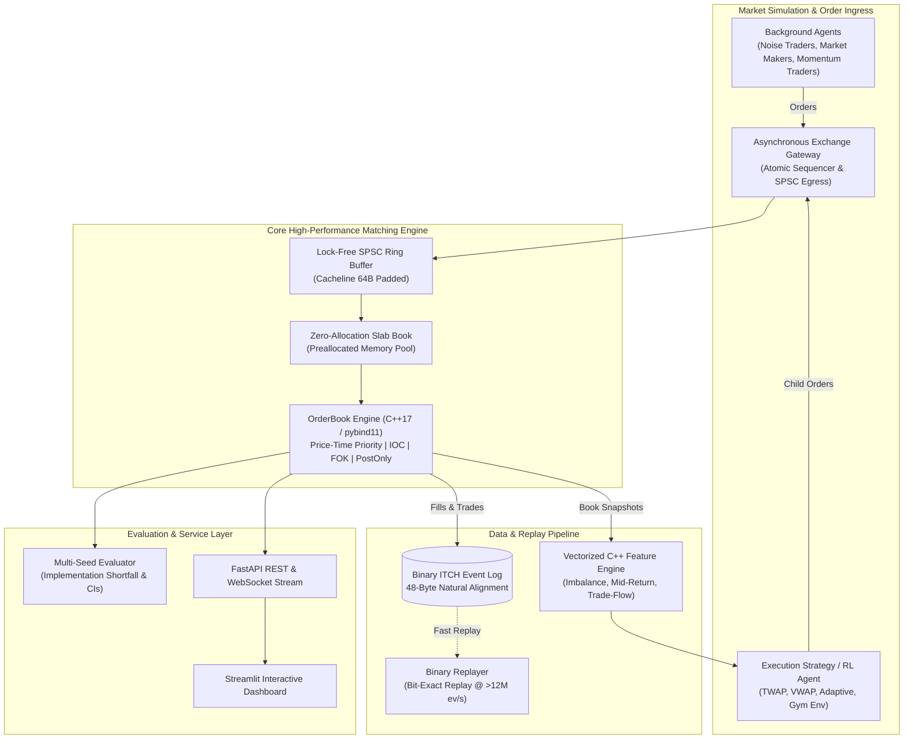

# LOBX

A high-performance limit-order-book exchange simulator with machine learning and reinforcement learning trade execution agents, implemented in **modern C++17** and **Python 3.11+**.

LOBX simulates an electronic financial exchange with an industrial matching engine, populates it with heterogenous algorithmic market participants (market makers, noise traders, momentum traders), and evaluates execution strategies (TWAP, VWAP, Microstructure-Adaptive, and Gymnasium RL) tasked with executing institutional parent orders at minimum implementation shortfall.

> **Simulation Disclaimer**: LOBX is a simulated quantitative trading and market microstructure research environment. No real market data, broker, or exchange is accessed. All performance and cost metrics reflect simulated dynamics under price-time priority.

---

## Key Highlights & Performance Milestones

* **High-Speed C++ Engine (5.22M orders/sec)**: Pure C++ matching engine achieving 5,220,442 orders/s with 124 ns median latency and 463 ns p99 latency (`lobx_bench 1000000`).
* **Python/C++ Extension Boundary**: Benchmark across 1,000,000 orders shows 724k ops/s wrapped (2.2x vs pure Python) and 1.07M ops/s raw (3.2x vs pure Python) due to per-order language crossing overhead (`benchmarks/bench_engines.py`).
* **Differential Testing**: Python reference and C++ native engines are differential-tested against 1,000,000 randomized orders to guarantee 100% invariant parity (`tests/test_native_differential.py`).
* **Institutional Execution Baseline**: Evaluated selling 3,000 shares across 5 simulated minutes on 200 held-out test seeds (seeds 1000–1199).
* **Passive Spread Capture Advantage**: Resting limit orders at the touch (`passive`: 19.25 bps) outperform aggressive market order slicing (`twap`: 56.54 bps) by **~37 bps** on 99% of seeds.
* **Honest ML Accounting**: While LightGBM predicts 1-second price movement with 0.599 accuracy (vs. 0.451 naive baseline), acting on 1-tick forecasts via market orders incurs spread/impact costs that exceed the forecast value, resulting in `adaptive` (19.45 bps) matching `passive` (19.25 bps) within noise.
* **Deterministic Event Log & Bit-Exact Replay**: Append-only event log capturing every order, cancellation, and execution, verified by cryptographic hash matching.

---

## Execution Benchmark Results

All benchmarks evaluate selling 3,000 shares (about 20% of market volume) across 5 simulated minutes (t=60s to t=360s) on 200 held-out test seeds (seeds 1000–1199). Cost is measured as **implementation shortfall in basis points** against the arrival mid-price (lower is better):

$$\text{Shortfall (bps)} = \frac{\bar{P}_{\text{exec}} - P_{\text{arrival}}}{P_{\text{arrival}}} \times 10{,}000$$

Command:
```bash
python -m lobx.cli eval --strategies twap,vwap,passive,adaptive --seeds 200 --plot docs/figures/comparison.png
```

| Strategy | Completed Seeds | Incomplete | Mean Cost (bps) | Std Dev (bps) | 95% Confidence Interval |
|---|---:|---:|---:|---:|---|
| **TWAP** | 198 | 2 | 56.54 | 41.14 | [50.77, 62.31] |
| **VWAP** | 197 | 3 | 57.81 | 42.22 | [51.88, 63.74] |
| **Passive Limit** | 200 | 0 | 19.25 | 19.54 | [16.53, 21.98] |
| **Adaptive ML** | 200 | 0 | 19.45 | 19.77 | [16.69, 22.20] |

Paired Differences by Seed ($a - b$ in bps; negative means $a$ is cheaper; complete seeds only):

| Comparison ($a - b$) | Seeds Used | Mean Difference (bps) | 95% Confidence Interval | $a$ Cheaper On | Verdict |
|---|---:|---:|---|---:|---|
| **vwap - twap** | 197 | +1.41 | [0.71, 2.10] | 26% of seeds | TWAP cheaper |
| **passive - twap** | 198 | -37.25 | [-41.44, -33.06] | 99% of seeds | Passive cheaper |
| **adaptive - twap** | 198 | -37.06 | [-41.26, -32.85] | 99% of seeds | Adaptive cheaper |
| **adaptive - passive** | 200 | +0.19 | [-0.06, 0.45] | 0% of seeds | No clear difference |

### Key Empirical Findings
1. **Passive Orders Earn the Spread**: Resting limit orders at the touch rather than crossing with aggressive market orders saves **~37 bps** across 99% of seeds.
2. **VWAP vs. TWAP Under Uniform Volume**: With background agents trading at stationary Poisson rates, the empirical volume profile is flat (~3.3% per slice), causing VWAP to perform essentially identically to TWAP (+1.41 bps difference due to volume profile estimation noise).
3. **The Limits of Short-Horizon Predictive Alpha**: The LightGBM model reliably predicts 1-second price direction (>0.59 accuracy vs. 0.45 naive baseline). However, paying the half-spread (2–4 ticks) to aggressively cross the book on a 1-tick forecast is unprofitable. The optimal policy tuned on validation seeds selected a high threshold (0.90) where aggressive orders almost never trigger, converging to the passive ablation.

---

## Architecture



---

## Repository Structure & Modules

| Component | Path | Description |
|---|---|---|
| **C++ Core Engine** | `cpp/src/order_book.cpp`, `cpp/include/lobx/order_book.hpp` | High-speed matching engine: price-time priority, partial fills, IOC, FOK, PostOnly, `submit_many`. |
| **Concurrency & Gateway** | `cpp/include/lobx/{gateway,concurrent_order_book,concurrent_queue}.hpp` | Asynchronous multi-threaded gateway with atomic request sequencing and read-write locked order book. |
| **Lock-Free Ring Buffer** | `cpp/include/lobx/spsc_ring_buffer.hpp` | Single-producer single-consumer lock-free ring buffer with cacheline padding to prevent false sharing. |
| **Slab Memory Pool** | `cpp/include/lobx/memory_pool.hpp`, `slab_order_book.hpp` | Slab allocation pool eliminating heap allocations on order placement hot path. |
| **Binary ITCH Codec** | `cpp/include/lobx/binary_log.hpp`, `cpp/src/binary_log.cpp` | 48-byte naturally aligned binary event format with ultra-fast serialization and replay. |
| **C++ Feature Extraction** | `cpp/include/lobx/features.hpp`, `cpp/src/features.cpp` | Vectorized order book imbalance, windowed mid returns, and signed trade-flow computation. |
| **Python Reference Engine** | `src/lobx/engine/book_py.py` | Readable Python reference implementation for differential testing and validation. |
| **Market Simulator** | `src/lobx/sim/` | Deterministic discrete-event simulation: clock, seeded RNG streams, U-shaped Poisson arrivals, and background population. |
| **Execution Strategies** | `src/lobx/strategies/` | TWAP, VWAP (with volume profile estimation), and adaptive strategies with deadline sweep guarantees. |
| **Gymnasium RL Env** | `src/lobx/rl/environment.py` | Standard RL environment (`ExecutionEnv`) with continuous observation and shortfall reward shaping. |
| **Machine Learning** | `src/lobx/ml/` | Short-horizon mid-price movement prediction using Logistic Regression and LightGBM models. |
| **Evaluation Harness** | `src/lobx/eval/` | Statistical multi-seed shortfall evaluator with lookahead leakage validation and paired comparison tests. |
| **Service & Dashboard** | `src/lobx/service/`, `dashboard/app.py` | Production-ready FastAPI service with WebSocket live book broadcast and Streamlit analytics dashboard. |

---

## Installation

### Prerequisites
* **Python**: 3.11 or newer
* **C++ Compiler**: GCC 11+, Clang 13+, or MSVC 2022 (supporting C++17)
* **CMake**: 3.18 or newer
* **Docker & Docker Compose** (optional, for containerized deployment)

### Local Setup
```bash
# Clone repository
git clone https://github.com/theRiddler9/lobx.git && cd lobx

# Install package and compile native C++ extension
pip install -e .

# Install with service & dashboard extras (FastAPI, Streamlit, Uvicorn)
pip install -e ".[service]"
```

Using `uv` (recommended for development):
```bash
uv sync --locked --all-extras
```

---

## Usage

### 1. Market Simulation & Deterministic Replay
```bash
# Simulate market for seed 42 and generate event log
python -m lobx.cli run --seed 42 --duration 300 --out run-seed-42.eventlog

# Replay log and verify bit-exact order book state
python -m lobx.cli replay run-seed-42.eventlog
```

### 2. Model Training & Execution Strategy Evaluation
```bash
# Train order-flow predictive models (Naive, Logistic Regression, LightGBM)
python -m lobx.cli train --out models

# Evaluate execution strategies over 200 held-out test seeds
python -m lobx.cli eval --strategies twap,vwap,passive,adaptive --seeds 200
```

### 3. Web Service & Live Interactive Dashboard
```bash
# Start FastAPI backend service (Swagger docs at http://localhost:8000/docs)
python -m lobx.cli serve --host 0.0.0.0 --port 8000

# Launch Streamlit visualizer (http://localhost:8501)
streamlit run dashboard/app.py
```

### 4. Docker Deployment
```bash
# Build and run full service stack in containers
docker compose up -d

# Verify service health
curl http://localhost:8000/health
curl http://localhost:8501/_stcore/health

# Stop services
docker compose down
```

---

## Benchmarks

### Engine Throughput and Boundary Benchmark

Commands to reproduce (documented in `docs/results.md`):

1. **Pure C++ Engine** (no Python runtime):
   ```bash
   cmake -S . -B build/cpp -DLOBX_BUILD_TESTS=ON -DCMAKE_BUILD_TYPE=Release
   cmake --build build/cpp
   ./build/cpp/lobx_bench 1000000
   ```

2. **Python Reference vs. Native Engine** (called from Python):
   ```bash
   python benchmarks/bench_engines.py --ops 1000000
   ```

| Engine Mode | Execution Environment | Throughput (orders/s) | Median Latency | p99 Latency | Speedup vs. Python |
|---|---|---:|---:|---:|---:|
| **Python Reference** | Pure Python 3.11+ | 335,980 | 2,153 ns | 11,321 ns | 1.0x |
| **C++ Native-Wrapped** | `NativeOrderBook` (dataclass bridge) | 724,793 | 841 ns | 5,101 ns | 2.2x |
| **C++ Native-Raw** | Pybind11 raw integer interface | 1,072,217 | 710 ns | 2,414 ns | 3.2x |
| **Pure C++ Engine** | Standalone C++17 binary | 5,220,442 | 124 ns | 463 ns | ~15.5x |

> [!NOTE]
> While pure C++ delivers **>5.2M orders/s (~15.5x speedup)** over Python reference, calling C++ from Python per-order drops effective speedup to **2.2x–3.2x** due to pybind11 translation overhead and GIL contention. This highlights why a vectorized C++ batch API (`submit_many`) is the focus of Phase A.

---

## Verification & Testing Suite

* **C++ Unit Tests & Sanitizers**: Verified under CTest with AddressSanitizer and UndefinedBehaviorSanitizer (`ctest --test-dir build/san`).
* **Python Test Suite (600 passing tests)**: Mechanics, invariant property tests (`hypothesis`), deterministic replay, and causality tests (`pytest`).
* **Lookahead Poison Test**: Mathematical verification that features at time $t$ do not access information $> t$; intentional leaks trigger `LookaheadError` (`pytest tests/test_leakage.py`).
* **Deterministic Event Log Replay**: Verification that runs produce identical logs from identical seeds, and replaying the log reproduces identical final book states (`python -m lobx.cli run` + `replay`).
* **CI Matrix**: Continuous integration builds and tests across Linux (`ubuntu-latest`) and macOS (`macos-latest`) on Python 3.11 and 3.13, plus native Docker Compose build & container healthcheck tests (`.github/workflows/ci.yml`).

---

## Project Documentation

* [`AGENTS.md`](AGENTS.md): Architectural contracts, development phases, and rules of engagement.
* [`docs/results.md`](docs/results.md): Full statistical benchmark ledger, commands, and confidence intervals.
* [`docs/architecture.md`](docs/architecture.md): Data flow boundaries, protocol guarantees, and subsystem diagrams.
* [`docs/learn/`](docs/learn/): Phase-by-phase learning modules, implementation walkthroughs, and practice exercises.
* [`docs/contracts/shared-contracts.md`](docs/contracts/shared-contracts.md): Exact cross-module types and protocol definitions.
