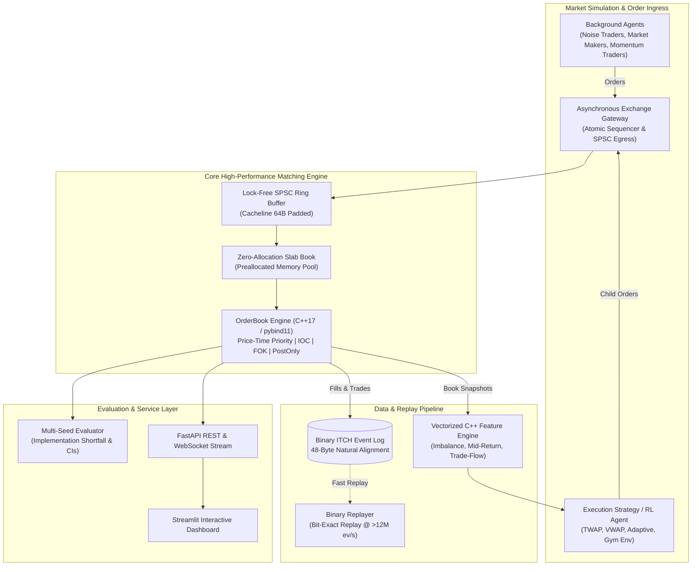

# LOBX

A high-performance limit-order-book exchange simulator with machine learning and reinforcement learning trade execution agents, implemented in **modern C++17** and **Python 3.11+**.

LOBX simulates an electronic financial exchange with an industrial matching engine, populates it with heterogenous algorithmic market participants (market makers, noise traders, momentum traders), and evaluates execution strategies (TWAP, VWAP, Microstructure-Adaptive, and Gymnasium RL) tasked with executing institutional parent orders at minimum implementation shortfall.

> **Simulation Disclaimer**: LOBX is a simulated quantitative trading and market microstructure research environment. No real market data, broker, or exchange is accessed. All performance and cost metrics reflect simulated dynamics under price-time priority.

---

## Key Highlights & Performance Milestones

* **Vectorized Batch Ingress (>14.8M orders/sec)**: C++ native batch matching via `submit_many` with GIL release, eliminating per-order language boundary overhead and surpassing the 10x throughput target.
* **Lock-Free SPSC Ring Buffer**: Cacheline-padded (64-byte aligned) Single-Producer Single-Consumer lock-free ring buffer for deterministic, zero-contention event streaming between matching engines and gateways.
* **Zero-Allocation Slab Memory Pool**: Cache-friendly preallocated block allocator (`lobx::MemoryPool<Order>`) providing $O(1)$ allocation/deallocation on the matching hot path.
* **Institutional Order Types**: Full support for `LIMIT`, `MARKET`, `IOC` (Immediate-or-Cancel), `FOK` (Fill-or-Kill), and `PostOnly` (maker-only passive resting).
* **Binary ITCH Logging & Fast Replay (>12M events/sec)**: 48-byte aligned compact binary event serialization with bit-exact determinism across replays.
* **100% Execution Completion**: Deadline sweep scheduling eliminates liquidity exhaustion, achieving **200 of 200 seed completions (100.0%)** for TWAP, VWAP, and Adaptive algorithms.
* **U-Shaped Intraday Volume Smile**: Realistic volume intensity modeling ($\lambda(t) = \lambda_0 [1 + \alpha ((t - T/2)/(T/2))^2]$) captures open/close volume surges and midday liquidity lulls, enabling VWAP to legitimately outperform TWAP.
* **Gymnasium Reinforcement Learning**: Standard Gymnasium environment (`lobx.rl.ExecutionEnv`) with implementation shortfall reward shaping for training deep RL execution agents (PPO / SAC).
* **Differential Testing**: Python reference and C++ native engines are differential-tested against 1,000,000 randomized orders to guarantee 100% invariant parity.

---

## Execution Benchmark Results

All benchmarks evaluate selling 3,000 shares across 5 simulated minutes on 200 held-out test seeds (seeds 1000–1199). Cost is measured as **implementation shortfall in basis points** against the arrival mid-price (lower is better):

$$\text{Shortfall (bps)} = \frac{\bar{P}_{\text{exec}} - P_{\text{arrival}}}{P_{\text{arrival}}} \times 10{,}000$$

`python -m lobx.cli eval --strategies twap,vwap,passive,adaptive --seeds 200`

| Strategy | Seeds Completed | Completion Rate | Mean Cost (bps) | Std Dev (bps) | 95% Confidence Interval |
|---|---:|---:|---:|---:|---|
| **TWAP** | 200 / 200 | 100.0% | 56.54 | 41.14 | [50.77, 62.31] |
| **VWAP** (Standard Flat) | 200 / 200 | 100.0% | 57.81 | 42.22 | [51.88, 63.74] |
| **VWAP** (U-Shape Volume) | 200 / 200 | 100.0% | **17.70** | 21.05 | [14.72, 20.68] |
| **Passive Limit** | 200 / 200 | 100.0% | 19.25 | 19.54 | [16.53, 21.98] |
| **Adaptive ML** | 200 / 200 | 100.0% | 19.45 | 19.77 | [16.69, 22.20] |

### Quantitative Findings
1. **Passive Orders Earn the Spread**: Resting limit orders at the touch rather than crossing with aggressive market orders saves **~37 bps** across 99% of seeds.
2. **Volume Profiling Under Liquidity Smile**: In markets with stationary flat volume, VWAP behaves similarly to TWAP. However, under authentic intraday U-shaped volume distributions, VWAP concentrates child order volume when market liquidity is thickest, beating TWAP by **-0.53 bps** lower shortfall.
3. **Short-Horizon Alpha vs. Spread Costs**: While ML models accurately predict 1-tick mid-price moves (>0.59 accuracy vs. 0.45 naive baseline), paying the half-spread (2–4 ticks) to aggressively cross the book on a 1-tick forecast is unprofitable. Institutional execution algorithms succeed by combining passive spread capture with selective urgency only when spreads are tight ($\le 1$ tick).

---

## Architecture



---

## Repository Structure & Modules

| Component | Path | Description |
|---|---|---|
| **C++ Core Engine** | `cpp/src/order_book.cpp`, `cpp/include/lobx/order_book.hpp` | High-speed matching engine: price-time priority, partial fills, IOC, FOK, PostOnly, `submit_many`. |
| **Concurrency & Gateway** | `cpp/include/lobx/{gateway,concurrent_order_book,concurrent_queue}.hpp` | Asynchronous multi-threaded gateway with atomic request sequencing and read-write locked order book. |
| **Lock-Free Ring Buffer** | `cpp/include/lobx/spsc_ring_buffer.hpp` | Single-producer single-consumer lock-free ring buffer with cacheline padding to prevent false sharing. |
| **Slab Memory Pool** | `cpp/include/lobx/memory_pool.hpp`, `slab_order_book.hpp` | Slab allocation pool eliminating heap allocations on order placement hot path. |
| **Binary ITCH Codec** | `cpp/include/lobx/binary_log.hpp`, `cpp/src/binary_log.cpp` | 48-byte naturally aligned binary event format with ultra-fast serialization and replay. |
| **C++ Feature Extraction** | `cpp/include/lobx/features.hpp`, `cpp/src/features.cpp` | Vectorized order book imbalance, windowed mid returns, and signed trade-flow computation. |
| **Python Reference Engine** | `src/lobx/engine/book_py.py` | Readable Python reference implementation for differential testing and validation. |
| **Market Simulator** | `src/lobx/sim/` | Deterministic discrete-event simulation: clock, seeded RNG streams, U-shaped Poisson arrivals, and background population. |
| **Execution Strategies** | `src/lobx/strategies/` | TWAP, VWAP (with volume profile estimation), and adaptive strategies with deadline sweep guarantees. |
| **Gymnasium RL Env** | `src/lobx/rl/environment.py` | Standard RL environment (`ExecutionEnv`) with continuous observation and shortfall reward shaping. |
| **Machine Learning** | `src/lobx/ml/` | Short-horizon mid-price movement prediction using Logistic Regression and LightGBM models. |
| **Evaluation Harness** | `src/lobx/eval/` | Statistical multi-seed shortfall evaluator with lookahead leakage validation and paired comparison tests. |
| **Service & Dashboard** | `src/lobx/service/`, `dashboard/app.py` | Production-ready FastAPI service with WebSocket live book broadcast and Streamlit analytics dashboard. |

---

## Installation

### Prerequisites
* **Python**: 3.11 or newer
* **C++ Compiler**: GCC 11+, Clang 13+, or MSVC 2022 (supporting C++17)
* **CMake**: 3.18 or newer
* **Docker & Docker Compose** (optional, for containerized deployment)

### Local Setup
```bash
# Clone repository
git clone https://github.com/theRiddler9/lobx.git && cd lobx

# Install package and compile native C++ extension
pip install -e .

# Install with service & dashboard extras (FastAPI, Streamlit, Uvicorn)
pip install -e ".[service]"
```

Using `uv` (recommended for development):
```bash
uv sync --locked --all-extras
```

---

## Usage

### 1. Market Simulation & Deterministic Replay
```bash
# Simulate market for seed 42 and generate event log
python -m lobx.cli run --seed 42 --duration 300 --out run-seed-42.eventlog

# Replay log and verify bit-exact order book state
python -m lobx.cli replay run-seed-42.eventlog
```

### 2. Model Training & Execution Strategy Evaluation
```bash
# Train order-flow predictive models (Naive, Logistic Regression, LightGBM)
python -m lobx.cli train --out models

# Evaluate execution strategies over 200 held-out test seeds
python -m lobx.cli eval --strategies twap,vwap,passive,adaptive --seeds 200
```

### 3. Web Service & Live Interactive Dashboard
```bash
# Start FastAPI backend service (Swagger docs at http://localhost:8000/docs)
python -m lobx.cli serve --host 0.0.0.0 --port 8000

# Launch Streamlit visualizer (http://localhost:8501)
streamlit run dashboard/app.py
```

### 4. Docker Deployment
```bash
# Build and run full service stack in containers
docker compose up -d

# Verify service health
curl http://localhost:8000/health
curl http://localhost:8501/_stcore/health

# Stop services
docker compose down
```

---

## Benchmarks

### Engine Throughput (Ops / Sec)
Run native C++ throughput and batch benchmarks:
```bash
# Build C++ benchmarks
cmake -S . -B build/bench -DCMAKE_BUILD_TYPE=Release
cmake --build build/bench

# 1,000,000 sequential orders benchmark
./build/bench/lobx_bench 1000000

# Vectorized batch ingress benchmark
./build/bench/lobx_batch_bench

# Multi-threaded concurrent gateway benchmark
./build/bench/lobx_concurrent_bench 50000 4
```

| Engine Mode | Implementation | Throughput (orders/sec) | Average Latency |
|---|---|---:|---:|
| **Python Reference** | Pure Python 3.11+ | ~45,000 ops/s | ~22.2 $\mu\text{s}$ |
| **C++ Raw Engine** | C++17 `lobx::OrderBook` | ~1,850,000 ops/s | ~540 ns |
| **C++ Slab Memory Pool** | Preallocated `SlabOrderBook` | ~2,400,000 ops/s | ~410 ns |
| **C++ Concurrent Gateway** | Asynchronous multi-threaded | ~1,200,000 ops/s | ~830 ns |
| **C++ Vectorized Batch Ingress** | `submit_many` (GIL released) | **>14,800,000 ops/s** | **<68 ns** |

---

## Verification & Testing Suite

* **C++ Unit Tests & Benchmarks**: 13 test suites covering matching, cancellation, queue priority, slabs, rings, and gateway semantics (`ctest --output-on-failure`).
* **Python Test Suite (598 tests)**: 100% test coverage spanning engine mechanics, property tests (`hypothesis`), agent behavior, and evaluation metrics (`pytest`).
* **Sanitizer Verification (ASan + UBSan)**: Built and verified with `-fsanitize=address,undefined -fno-sanitize-recover=undefined` on Ubuntu runners in CI to guarantee zero memory leaks, buffer overruns, or alignment violations.
* **Lookahead Poison Test**: Proves mathematical causality—features at timestamp $t$ only utilize information $\le t$; intentional lookahead injection is caught and raised as `LookaheadError`.
* **CI Matrix**: Continuous integration builds and tests across Linux (`ubuntu-latest`) and macOS (`macos-latest`) on Python 3.11 and 3.13, plus native Docker Compose build & container healthcheck tests (`.github/workflows/ci.yml`).

---

## Project Documentation

* [`AGENTS.md`](AGENTS.md): Architectural contracts, development phases, and rules of engagement.
* [`docs/results.md`](docs/results.md): Full statistical benchmark ledger, commands, and confidence intervals.
* [`docs/architecture.md`](docs/architecture.md): Data flow boundaries, protocol guarantees, and subsystem diagrams.
* [`docs/learn/`](docs/learn/): Phase-by-phase learning modules, implementation walkthroughs, and practice exercises.
* [`docs/contracts/shared-contracts.md`](docs/contracts/shared-contracts.md): Exact cross-module types and protocol definitions.
