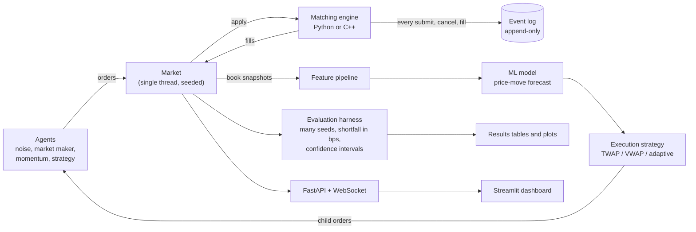

# Architecture

## The pipeline

## One tick of a simulation

1. The market pops the next wake-up from its queue (timestamp order, one thread).
2. It asks that agent for actions, giving it a read-only `MarketView` and the agent's own seeded
   random stream.
3. It applies each action to the matching engine. The engine matches by price-time priority, trades
   at the resting order's price, and appends every submit, cancel and fill to the event log.
4. Fills update positions and the public trade tape. The agent's next wake-up is queued.

## Who may touch what

| Component | Reads | Never does |
|---|---|---|
| Engine (`engine/`, `cpp/`) | orders | contain agent or ML logic |
| Simulator (`sim/`) | the engine through the `OrderBook` protocol | reach into engine internals |
| Strategies (`strategies/`) | a `MarketView` (snapshots, trade tape, own position) | change the book directly |
| ML (`ml/`) | snapshots and fills | touch the engine; use data after time t |
| Evaluation (`eval/`) | fill lists and run results | change a run's behaviour |
| Service (`service/`, `dashboard/`) | the harness and its results | add trading logic |

## The two engines

`PythonOrderBook` (`engine/book_py.py`) is the readable reference. `NativeOrderBook`
(`engine/native.py`) wraps the C++ engine (`cpp/`, bound with pybind11). Both implement the
`OrderBook` protocol in `engine/protocol.py`. C++ keeps a `std::map` of price levels per side, a
`std::list` of orders per level (FIFO), and a hash index from order id to its list position so a
cancel is O(1). `tests/test_native_differential.py` feeds both engines the same random orders and
requires identical fills, cancel results, best prices and snapshots.

## Why the stages are separate

- **Determinism.** Randomness comes only from seeded streams passed in explicitly, so the same
  `(config, seed)` gives a byte-identical event log. This is what makes paired comparisons and
  replay possible.
- **No leakage.** Strategies and features receive only data up to the current time; tests inject a
  lookahead bug and require it to be caught.
- **Fair comparison.** Every strategy runs on the same seeds, so the starting market is identical
  and per-seed differences cancel shared luck.
